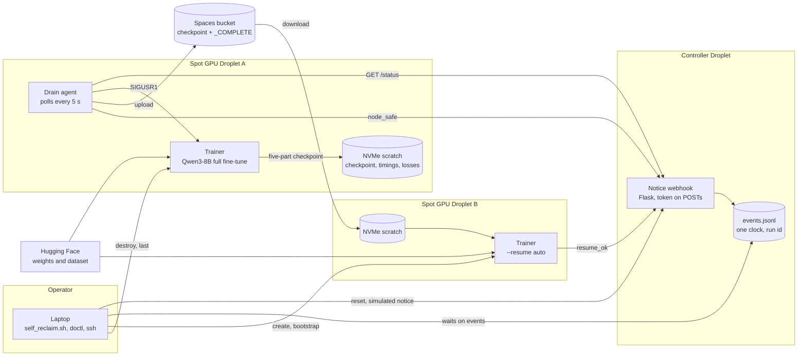
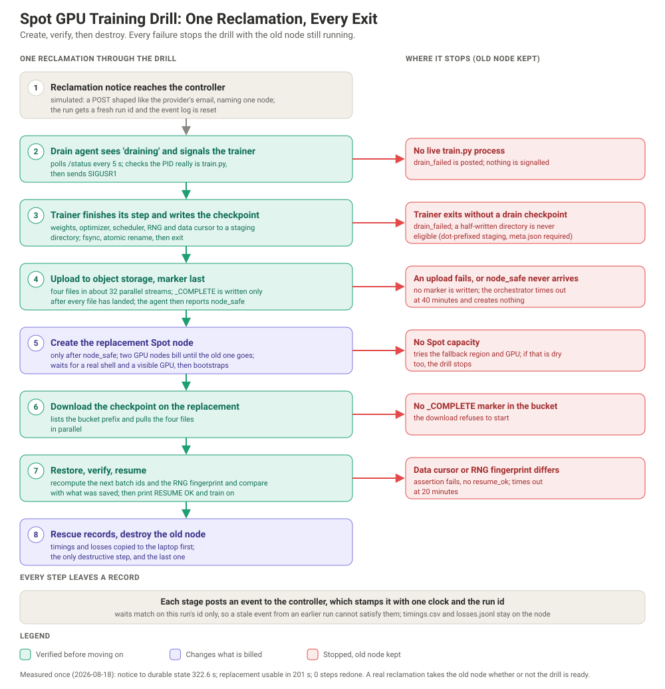
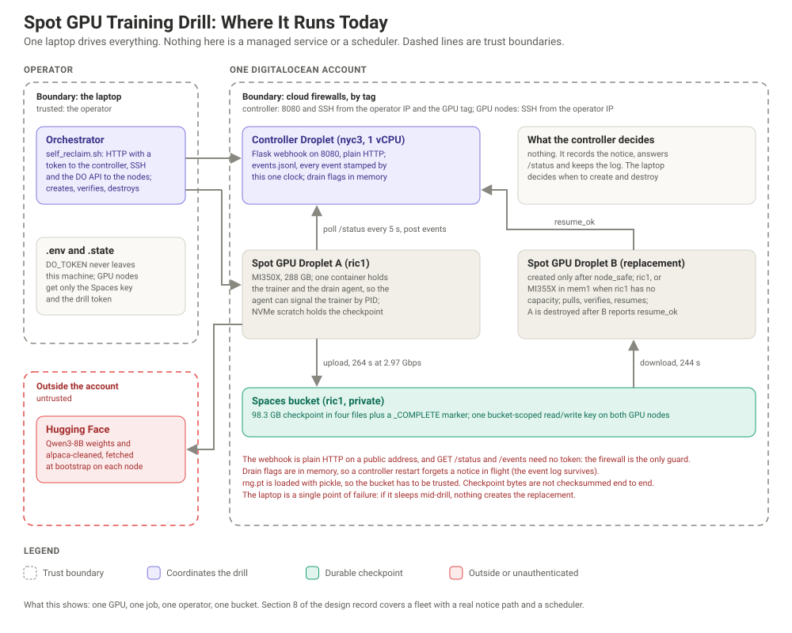

# Spot GPU Training Drill design record

Written 2026-11-16 against commit `dd818aa`. It covers why the drill is built the way it is: what it
has to prove, the choices made and what each one costs, the numbers measured so far, and what would
have to change to run it for a fleet. For how to run it, see the README and the runbook.

This is a drill that ran once, not a training platform. Section 7 lists what stands between the two.

## 1. The problem

Spot GPUs are cheaper because the provider can take them back. For inference that is a retry. For a
full fine-tune it is a question about state: a run holds tens of gigabytes of weights and optimizer
moments in GPU memory, and when the node goes, so does every step since the last checkpoint.

So the engineering question is not "can spot be used for training?" It is three numbers:

1. How long does it take, from the notice, to get the complete training state somewhere durable?
2. How long until a replacement node is training again?
3. How much work is redone?

If the first number fits inside the provider's notice window with room to spare, spot is usable for
training. If it does not, the cost of spot has to include periodic checkpoints and lost steps. The
drill measures all three on real hardware, with a real 8-billion-parameter model, and checks that
the resumed run is the same run and not just one that loads.

## 2. Requirements

What it has to do:

| # | Requirement | Where it is met |
|---|-------------|-----------------|
| R1 | Run a real full fine-tune, not a toy, so the checkpoint is realistically large | `trainer/train.py` (Qwen3-8B, fp32 master weights, bf16 autocast) |
| R2 | On a notice, save everything needed to continue exactly: weights, optimizer, scheduler, RNG, data position | `save_checkpoint()` |
| R3 | Get that state off the node before the node is gone | `trainer/uploader.py`, `drain/drain_agent.py` |
| R4 | Bring up a replacement, restore, and prove the resume is correct | `drain/self_reclaim.sh`, `load_checkpoint()`, `trainer/continuity.py` |
| R5 | Time every stage on one clock | `drain/notice_webhook.py`, `drain/timeline.py` |
| R6 | Say what the numbers mean for larger models without claiming to have measured them | `trainer/scale_model.py` |

How it has to behave:

| # | Requirement | Design response |
|---|-------------|-----------------|
| N1 | Never destroy the only copy of the work | Create, verify, then destroy. The old node goes last |
| N2 | A partial checkpoint is never used | Staging directory, fsync, atomic rename, `_COMPLETE` marker written last, download refuses without it |
| N3 | Every wait ends | 40 minutes for `node_safe`, 20 for `resume_ok`, 15 for a shell, 10 for the GPU |
| N4 | An old run cannot satisfy a new one | Every event carries a run id; waits match on this run's id |
| N5 | A failed drill does not keep billing unnoticed | Error traps print the Droplets still running; teardown is by tag |
| N6 | Simulated parts are labelled | README, runbook and results all say the notice was simulated and `n = 1` |

## 3. Architecture

Four machines and a bucket. The laptop decides, the controller records, the GPU nodes do the work,
and the bucket is the only durable thing.

| Component | What it holds | What it decides |
|-----------|---------------|-----------------|
| Laptop | The cloud API token, `.env`, `.state` | When to create the replacement and when to destroy the old node |
| Controller | The event log and the drain flags | Nothing. It records and answers `/status` |
| Drain agent | Nothing | When the node is safe: checkpoint written and uploaded |
| Trainer | The training state | When to stop: at the end of the step in which the signal arrived |
| Spaces bucket | The checkpoint | Nothing. A checkpoint counts only if its marker is there |

### One reclamation through the drill

Eight steps, and the six places it stops with the old node still running.

### Where it runs today

One laptop, one controller, one GPU node at a time (two during the overlap), one bucket. Dashed
lines are trust boundaries. Section 8 covers what changes for a fleet.

## 4. Decisions

Each decision lists the choice, the option not taken, the reason, and the cost.

### D1. A simulated notice through the real drain path

- **Choice.** The laptop posts a notice shaped like the provider's reclamation email to the
  controller. Everything after that runs for real: signal, checkpoint, upload, replacement, restore,
  verify, resume, destroy.
- **Not taken.** Waiting for a real reclamation, or mocking the whole sequence.
- **Why.** The provider offers no way to schedule a reclamation, and in the current preview the notice
  arrives by email. A drill that cannot be triggered cannot be measured or repeated. The trigger is
  the one part that does not change the numbers.
- **Cost.** The path from a real email to the webhook is not built or timed. A real reclamation also
  ends with the provider taking the node, on the provider's schedule. In the drill the operator
  destroys it after the replacement is verified, which is the best case.

### D2. Checkpoint the full training state, on a signal

- **Choice.** On `SIGUSR1` the trainer finishes its current step and saves five things: fp32 weights,
  the optimizer state with both Adam moments, the scheduler, all four RNG states, and the data cursor
  with the ids of the next batch.
- **Not taken.** Saving weights only. Checkpointing on a timer only.
- **Why.** Weights alone restart Adam's moments from zero, and the run that resumes is a different
  run. Finishing the step means no partial step is ever saved. A signal lets the checkpoint happen
  when it is needed, not every N steps at 98 GB each.
- **Cost.** 12 bytes per parameter: 98.3 GB for an 8B model. The default is `--ckpt-every 0`, so with
  no notice (a hardware failure, a notice that never arrives) every step since the start is lost.
  At a larger scale, periodic checkpoints stop being optional (section 8).

### D3. Local NVMe first, then object storage, with completeness checked at each layer

- **Choice.** Write to a dot-prefixed staging directory on local scratch, fsync every file, rename
  into place, fsync the directory. Then upload the four files in about 32 parallel streams and write
  `_COMPLETE` only after every upload returns. The download refuses to start without the marker.
- **Not taken.** Streaming the checkpoint straight to object storage.
- **Why.** N2. The local write takes 56.5 s and the upload 264 s. Writing locally first releases the
  GPU's state to disk quickly and gives the upload a stable file to retry from. Each layer can fail
  in its own way, such as a crash mid-write or one failed part, and each has its own check.
- **Cost.** Scratch space equal to the checkpoint. The state is not durable until the upload ends,
  5.4 minutes after the notice. There is no checksum of the bytes end to end: the marker says every
  upload call returned, not that the downloaded files match.

### D4. Create, verify, then destroy

- **Choice.** The replacement is created only after `node_safe`. The old node is destroyed only after
  the replacement posts `resume_ok` and its log shows `RESUME OK`. Its timing and loss files are
  copied to the laptop first.
- **Not taken.** Destroying the old node once the checkpoint is uploaded, and assuming capacity for a
  replacement.
- **Why.** N1. Spot capacity is as-available. If no replacement can be had, the old node is still the
  fastest way to keep training, and the checkpoint in the bucket has not yet been proven loadable.
- **Cost.** Two GPU nodes bill during the overlap, about 10 minutes by the reference run's stage timings. In a real
  reclamation this ordering is not available, because the provider removes the node. What carries
  over is the rule that nothing is deleted until the copy has been proven.

### D5. Prove the resume by recomputation, then by replay

- **Choice.** The checkpoint stores the ids of the batch the next step will use and a fingerprint of
  the RNG states. On resume both are recomputed from the restored state and asserted equal before
  `RESUME OK` is printed. `continuity.py` then compares losses across several resumes from the same
  checkpoint.
- **Not taken.** Treating a successful `load_state_dict` as proof. Comparing one resumed loss curve
  against the original.
- **Why.** A load that succeeds can still be the wrong position in the data or a reseeded RNG. A
  two-column loss comparison misleads the other way: from the second resumed step the losses differ
  in the fourth decimal because GPU reductions are not order-stable. Three columns show that resumes
  differ from each other by as much as they differ from the original.
- **Cost.** It proves the state was restored, not that training is bit-identical afterwards. On the
  drill's resume the cosine schedule is rebuilt from a different `--max-steps` (current step plus
  100), so the learning rate after resume is not the original curve. That is fine for a 100-step
  proof and wrong for a real run.

### D6. One clock for every interval

- **Choice.** Nodes post events to the controller, which stamps each with its own time and the run id.
  Intervals between nodes are computed only from those stamps.
- **Not taken.** Each node's own timestamps.
- **Why.** R5. The headline number spans three machines, and two Droplets that disagree by a second
  corrupt a 56-second measurement by 2%.
- **Cost.** Every interval includes the network delay of posting the event. The controller becomes
  something the drill depends on: its drain flags live in memory, so a restart mid-drill forgets the
  notice and the agent goes on seeing `running`. The event log is a file and survives.

### D7. A laptop and shell scripts, not a scheduler

- **Choice.** `self_reclaim.sh` on the operator's laptop runs the sequence with `doctl` and `ssh`.
- **Not taken.** A Kubernetes operator, a job scheduler, or infrastructure-as-code.
- **Why.** The drill exists to measure and to be read. Each stage is one visible command with one
  timing, and nothing sits between the reader and what the cloud was asked to do.
- **Cost.** The laptop is a single point of failure: if it sleeps after `node_safe`, nothing creates
  the replacement. One job, one node, one operator. Nothing here would run unattended.

### D8. A fallback region and GPU model

- **Choice.** If the primary region has no capacity, the script tries a second size in a second
  region (MI355X in `mem1` in the reference configuration).
- **Not taken.** Waiting for the primary region, or failing.
- **Why.** Each single-GPU spot size was offered in exactly one region, so a second region means a
  different GPU model. Stopping the job is worse than switching GPUs.
- **Cost.** A different GPU changes throughput and float behaviour. The checkpoint then has to cross
  regions, which was not measured and will be slower than the same-region 3 Gbps.

### D9. Keep the cloud token on the laptop and guard the rest with a firewall

- **Choice.** `DO_TOKEN` is never sent to a node. GPU nodes get a Spaces key scoped to one bucket and
  the drill token. POSTs to the controller need the token. Firewalls are attached by tag, so a
  replacement created mid-drill is covered without anyone remembering to do it.
- **Not taken.** TLS and authentication on every route. A secrets manager.
- **Why.** The node most likely to be lost, or left running by mistake, should hold the least. A key
  that can write one bucket is a smaller loss than a token that can create GPUs.
- **Cost.** The webhook is plain HTTP on a public address, so the drill token crosses the internet in
  clear text. `GET /status` and `GET /events` need no token. The firewall is the only guard, and it
  is pinned to the operator's IP at creation time. `rng.pt` is loaded with pickle, so anyone who can
  write the bucket can run code on the replacement node.

### D10. Projections are labelled as projections

- **Choice.** `scale_model.py` scales the measured bytes per parameter and transfer rates to larger
  models, prints which inputs were measured, and gives training cost as a range over an assumed
  utilisation.
- **Not taken.** Quoting vendor throughput, or a single-point cost for a 70B run.
- **Why.** The drill measured checkpoint and transfer rates. It did not measure training throughput.
  A cost claim built on an unmeasured utilisation figure would not survive a question.
- **Cost.** The 70B numbers are upper bounds from a single-GPU code path. A sharded multi-GPU
  checkpoint is different code and would probably be faster.

## 5. Measured results

One run, 2026-08-18. Qwen3-8B full fine-tune on one AMD Instinct MI350X Spot GPU Droplet in `ric1`,
with Spaces in the same region. Raw logs are not in the repository because they contain
infrastructure identifiers.

| Stage | Result |
|-------|-------:|
| Checkpoint size | 98.3 GB (12.0 bytes per parameter) |
| Write to local NVMe | 56.5 s (1.74 GB/s) |
| Upload to Spaces | 264 s (2.97 Gbps) |
| **Notice to durable state** | **322.6 s (5.4 min)** |
| Replacement: create to usable GPU | 201 s |
| Bootstrap | 96 s |
| Checkpoint download | 244 s (3.23 Gbps) |
| Load, verify, resume | about 40 s |
| Resume point | step 14,625 |
| **Steps redone** | **0** |
| GPU cost of the reference run | about $20 |

The stages add up to 904 s, about 15 minutes from notice to training again. That figure is a sum of
stages each timed separately, not one stopwatch run. All of it is `n = 1`.

Against the provider's best-effort notice target of 2 hours, the drain used 4% of the window. That
is the margin that makes spot usable for a model this size.

**Projection** (`python3 trainer/scale_model.py --crossover`, re-run for this record, same output).
It takes the measured bytes per parameter and rates on a single node and scales them:

| Model | Checkpoint | Drain (write + upload) | Share of a 2-hour notice |
|-------|-----------:|-----------------------:|-------------------------:|
| Qwen3-8B (measured) | 98 GB | 5.2 min | 4% |
| 13B | 156 GB | 8.3 min | 7% |
| 32B | 394 GB | 21.0 min | 17% |
| 70B | 847 GB | 45.1 min | 38% |
| 235B | 2,820 GB | 2.5 h | 125% |

The single-node drain uses the whole 2-hour notice at about 188B parameters. Full recovery for 70B
projects to 1.4 hours. These are arithmetic on measured rates, not measurements, and the 70B path
would use a sharded checkpoint that this code does not have.

**Not measured:** training throughput, a real reclamation, the email-to-webhook path, cross-region
transfer, a fallback to the second GPU model, any repeat of the full drill, and anything about
serving (the serving code exists and has not been run on a GPU).

**Tests.** None for the drill. CI compiles the Python and runs `bash -n` on the shell scripts. The
drill's correctness evidence is the reference run and the assertions inside `load_checkpoint()`.
The serving half, added later, has unit tests and offline manifest validation in CI. Those show
the serving tools are internally correct. They are not measurements, and they say nothing about
the drill.

## 6. Failure and threat model

| What goes wrong | Covered by | What is left |
|-----------------|-----------|--------------|
| Node reclaimed with a notice | The drain path, measured at 5.4 min | A notice shorter than the drain. The 2-hour target is best effort |
| Node lost with no notice | Nothing by default (`--ckpt-every 0`) | Every step since the start. `--ckpt-every N` exists but its cost in training time was not measured |
| Checkpoint half-written when the node dies | Staging directory, fsync, atomic rename; `meta.json` required | None known |
| Upload incomplete | `_COMPLETE` written last; download refuses without it | Bytes are not checksummed after download |
| No replacement capacity | Fallback region and GPU; old node kept; checkpoint already in the bucket | Both regions dry: the job waits for a person |
| Resume loads but is the wrong state | Data cursor and RNG fingerprint asserted | Scheduler curve rebuilt from a different step budget on the drill's resume |
| Losses differ after resume | Three-column replay shows GPU float noise | Not bit-identical, and cannot be on this hardware |
| Stale event from an earlier run satisfies a wait | Run id on every event, log reset per run | `/status` is not scoped by run; the reset clears it |
| Wrong node drained | Notice names one node; container shares the Droplet's hostname, checked at bootstrap | A notice with no target drains every node |
| Controller restarts mid-drill | Event log is a file | Drain flags are in memory; the agent never sees the notice |
| Laptop sleeps or loses its network | Bounded waits, error trap lists billing Droplets | Nothing continues the drill. Two nodes may keep billing |
| Someone reads the event log or status | Firewall limited to the operator IP and the GPU tag | No token on GETs; no TLS |
| Someone posts a fake notice | Token on POSTs | The token travels in clear text; a fake notice only stops training, after a checkpoint |
| Someone writes to the bucket | Bucket-scoped key, private bucket | `rng.pt` is unpickled on load: bucket write is code execution on the GPU node |
| Cloud token leaks from a GPU node | It is never sent there | The Spaces key and drill token are on every GPU node |
| Scratch format hits the wrong disk | Refuses the root device and non-block devices; manual check in the runbook | A wrong non-root device with no filesystem on it is still formatted |
| Resources left billing | Traps, tag-scoped teardown, receipts from the provider's API | The controller, bucket and keys are deleted by hand |

## 7. What stands between this and production

1. **It ran once.** No variance, no failure injection, no second region, no real reclamation.
2. **The notice path is simulated.** The email-to-webhook hop is neither built nor timed.
3. **No periodic checkpoint by default.** A loss without notice loses the run.
4. **A person at a laptop is the control loop.** There is no scheduler, no queue of jobs, and no
   retry of the orchestration itself.
5. **The controller keeps drain state in memory** and serves plain HTTP with unauthenticated reads.
6. **No integrity check on the checkpoint bytes,** and one file is loaded with pickle.
7. **Single GPU.** The checkpoint is one `torch.save` per component. A multi-GPU job needs a sharded
   save and a sharded restore.
8. **The scheduler curve is not restored exactly** on the drill's resume command.
9. **No tests.** Nothing checks the drain choreography without a GPU.
10. **The serving half is written but has not run.** `serving/` holds vLLM manifests for a
    Kubernetes Spot GPU node pool, autoscaling on in-flight requests, a load generator and a cost
    per million tokens calculator, with a runbook in `SERVING.md`. All of it was built and tested
    without a GPU: the manifests against schemas, the tools against a fake server. None of it has
    been applied to a cluster or run on a GPU. There is no measured throughput, latency,
    autoscaling time or cost per token. Producing those is the paid session in phase 6 of the plan.

## 8. What changes at 100 times the scale

There are two ways to grow: a fleet of 100 spot nodes running many jobs, or one job 10 to 30 times
larger across many GPUs. Nothing in this section is built, except the serving code noted in its
row, which is written and has not been run. It shows where the current seams are and what goes
behind them.

| Area | Today | At scale | Seam that already exists |
|------|-------|----------|--------------------------|
| Orchestration | A shell script on a laptop | A controller loop per job (a Kubernetes operator or a queue worker) that runs the same create, verify, destroy sequence unattended and can itself restart | The sequence is already a list of events with bounded waits |
| Notice | Simulated POST | Inbound-mail hook, or a provider signal when one exists, parsed to a node id, with the hop timed | `/notice` already takes a target node |
| Controller | One Flask process, flags in memory, HTTP | State in a store that survives a restart, TLS, authentication on reads, several replicas | Events are already an append-only log keyed by run id |
| Checkpoint trigger | On signal only | On signal, plus a periodic checkpoint whose interval is set from the measured write time and the observed reclamation rate | `--ckpt-every`, `SIGUSR2` |
| Checkpoint format | Four files from one GPU, pickle for RNG | Sharded per rank, written and uploaded in parallel across nodes, safetensors with a manifest of sizes and hashes | Marker-last protocol; `weights_only=True` already used for three of four files |
| Transfer | One node, about 32 streams, 3 Gbps, full copy each time | Parallel across ranks; incremental or deduplicated uploads so a notice only has to move the delta since the last periodic checkpoint | `uploader.py` is separate from the trainer and already single-flight |
| Capacity | One fallback region | Placement across regions and GPU models by live price and availability, with on-demand as the last resort and a budget cap | `01_create_spot.sh` takes a region and looks up the live price |
| Verification | Cursor and RNG asserted once | The same assertions, plus a checksum manifest, plus a held-out eval after resume to catch a silent quality change | `meta.json` carries the expected state |
| Cost | A receipt per Droplet | Cost per job with the reclamation tax in it: overlap billing, redone steps, checkpoint time, stated against the on-demand price | Price recorded on every `provisioned` event |
| Observability | An event log and a timeline script | The same events as metrics and traces: drain time, time to resume, steps lost, per job and per region | Single-clock events with stage durations |
| Serving | Code only, not run on a GPU: `serving/` and `SERVING.md`. No serving numbers | Inference on the same GPUs with autoscaling, where reclamation is a drained connection, not lost state. Then an on-demand pool behind the Spot pool, because a Spot pool is reclaimed whole | `serving/k8s` drains a pod in two steps and scales on in-flight requests; `queue_demo/` shows lease, acknowledge and retry for batch inference |

The order to do them in: repeat the drill first, including a run with no notice and one that falls
back to the second region, because one data point is not a distribution. Then periodic checkpoints
and a checksum manifest, which close the two ways to lose a run. Then replace the laptop with a
loop that can restart. Sharded checkpoints come with the first multi-GPU job.
